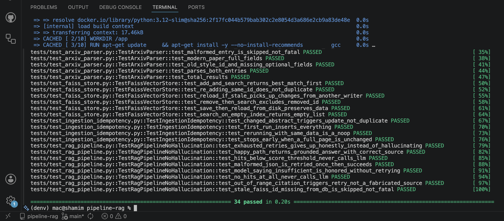
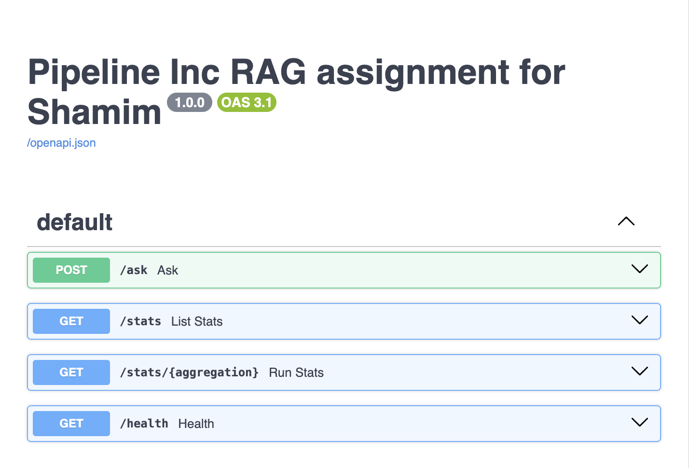
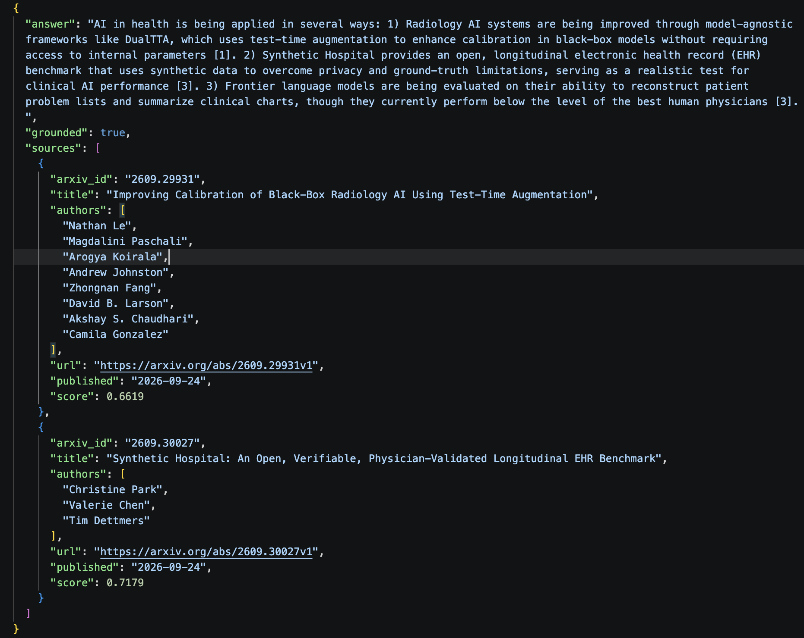
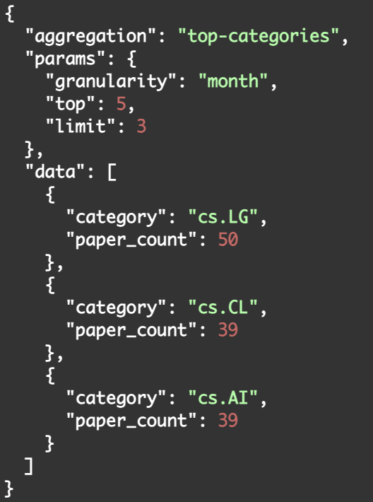

### Architecture

```text
                         ┌──────────────────────────┐
                         │          FastAPI         │
                         │                          │
                         │ POST /ask                │
                         │ GET  /stats/{aggregation}│
                         │ GET  /health              │
                         └────────────┬─────────────┘
                                      │
                    ┌─────────────────┴─────────────────┐
                    │                                   │
             ┌──────▼──────┐                    ┌───────▼───────┐
             │  RAGService │                    │  StatsService │
             │             │                    │               │
             │ retrieve    │                    │ Strategy      │
             │ → filter    │                    │ registry      │
             │ → context   │                    └───────┬───────┘
             │ → LLM       │                            │
             │ → validate  │                            │
             └──────┬──────┘                            │
                    │                                   │
        ┌───────────┼───────────────┐                   │
        │           │               │                   │
   ┌────▼────┐ ┌────▼────────┐ ┌────▼──────────────────▼───┐
   │ Embedder│ │ VectorStore │ │      PaperRepository       │
   │         │ │             │ │                            │
   │FastEmbed│ │   FAISS     │ │       PostgreSQL           │
   └─────────┘ └──────┬──────┘ └──────────────▲─────────────┘
                      │                       │
                      │                       │
   ┌──────────────────┴───────────────────────┴──────────────┐
   │                         CLI                              │
   │                                                          │
   │  ingest ──────► IngestionService                         │
   │  reindex ─────► IndexingService                          │
   │  wipe ────────► Database / index management              │
   └───────────────────────┬──────────────────────────────────┘
                           │
                           ▼
                 ┌─────────────────────┐
                 │     ArxivClient     │
                 │                     │
                 │ feed                │
                 │ rate limiting       │
                 │ retry               │
                 └──────────┬──────────┘
                            │
                            ▼
                 ┌─────────────────────┐
                 │ Parser / Cleaner    │
                 │                     │
                 │ feed → PaperRecord  │
                 └──────────┬──────────┘
                            │
                            ▼
                 ┌─────────────────────┐
                 │ PostgreSQL Upsert   │
                 │                     │
                 │ content hash        │
                 │ idempotency         │
                 └─────────────────────┘


      IndexingService
            │
            ├── finds papers whose embeddings are stale
            │
            ▼
      FastEmbed → FAISS
            │
            ▼
      Atomic index replacement


  ┌──────────────────────────────────────────────────────────┐
  │ PostgreSQL = source of truth                             │
  │ FAISS      = derived, rebuildable vector index           │
  └──────────────────────────────────────────────────────────┘
```

### RAG Pipeline

```text
User
 │
 │ POST /ask
 ▼
FastAPI
 │
 ▼
RAGService
 │
 ├──► Embed query
 │
 ├──► FAISS retrieval
 │       │
 │       └──► Top-K candidates
 │
 ├──► Filter / rerank
 │
 ├──► Build context
 │
 ├──► Generate answer
 │
 └──► Validate citations / grounding
          │
          ├── valid ───────► Answer
          │
          └── invalid ─────► Retry / NoMatch
```

### Data & Indexing Flow

```text
arXiv
  │
  ▼
ArxivClient
  │
  ├── rate limiting
  └── retries
  │
  ▼
Parser + Cleaner
  │
  ▼
PaperRecord
  │
  ▼
PostgreSQL
  │
  │ source of truth
  ▼
IndexingService
  │
  ├── detect stale/missing embeddings
  ├── generate embeddings
  └── update FAISS
  │
  ▼
FAISS
  │
  └── derived / rebuildable index
```
> **PostgreSQL is the source of truth; FAISS is a derived, rebuildable search index.**

### DB Schema:
```sql
CREATE TABLE categories (
  id    SERIAL PRIMARY KEY,
  code  TEXT NOT NULL UNIQUE                 -- 'cs.AI'
);

CREATE TABLE papers (
  id                   BIGSERIAL PRIMARY KEY,   -- also the FAISS id
  arxiv_id             TEXT NOT NULL UNIQUE,    -- '2401.01234' (version stripped; old style 'hep-th/9901001')
  version              SMALLINT NOT NULL,
  title                TEXT NOT NULL,
  abstract             TEXT NOT NULL,           -- cleaned
  primary_category_id  INT NOT NULL REFERENCES categories(id),
  published_at         TIMESTAMPTZ NOT NULL,
  updated_at           TIMESTAMPTZ NOT NULL,
  doi                  TEXT,
  journal_ref          TEXT,
  url                  TEXT NOT NULL,
  content_hash         CHAR(64) NOT NULL,       -- sha256(title || abstract)
  created_at           TIMESTAMPTZ NOT NULL DEFAULT now(),
  synced_at            TIMESTAMPTZ NOT NULL DEFAULT now()
);
CREATE INDEX ix_papers_published ON papers (published_at);
CREATE INDEX ix_papers_primary_cat ON papers (primary_category_id);

CREATE TABLE paper_categories (
  paper_id    BIGINT NOT NULL REFERENCES papers(id) ON DELETE CASCADE,
  category_id INT    NOT NULL REFERENCES categories(id),
  PRIMARY KEY (paper_id, category_id)
);
CREATE INDEX ix_pc_category ON paper_categories (category_id, paper_id);

CREATE TABLE authors (
  id               BIGSERIAL PRIMARY KEY,
  name             TEXT NOT NULL,
  name_normalized  TEXT NOT NULL UNIQUE         -- lower, stripped, collapsed whitespace
);

CREATE TABLE paper_authors (
  paper_id  BIGINT NOT NULL REFERENCES papers(id) ON DELETE CASCADE,
  author_id BIGINT NOT NULL REFERENCES authors(id),
  position  SMALLINT NOT NULL,                  -- author order matters
  PRIMARY KEY (paper_id, author_id),
  UNIQUE (paper_id, position)
);
CREATE INDEX ix_pa_author ON paper_authors (author_id);

-- Which papers are currently embedded, and with what
CREATE TABLE paper_embeddings (
  paper_id     BIGINT PRIMARY KEY REFERENCES papers(id) ON DELETE CASCADE,
  content_hash CHAR(64) NOT NULL,
  model        TEXT NOT NULL,
  embedded_at  TIMESTAMPTZ NOT NULL DEFAULT now()
);

CREATE TABLE ingestion_runs (
  id SERIAL PRIMARY KEY, started_at TIMESTAMPTZ, finished_at TIMESTAMPTZ,
  status TEXT, fetched INT, inserted INT, updated INT, error TEXT
);
```
#### Project Structure
```text
pipeline-rag/
│
├── app/
│   ├── config.py                    # Application configuration
│   ├── domain/
│   │   └── models.py                # PaperRecord, RetrievedChunk, Answer
│   │
│   ├── ports.py                      # Interfaces / dependency inversion
│   │                                # PaperSource, Embedder, VectorStore,
│   │                                # LLMClient, Reranker, PaperRepository
│   │
│   ├── adapters/                     # External system implementations
│   │   ├── arxiv_client.py           # HTTP + rate limiting + retries
│   │   ├── arxiv_parser.py           # Feed → PaperRecord
│   │   ├── text_cleaner.py
│   │   ├── fastembed_embedder.py
│   │   ├── faiss_store.py
│   │   ├── llm_anthropic.py
│   │   └── sql_repository.py
│   │
│   ├── db/
│   │   ├── models.py                 # SQLAlchemy models
│   │   └── session.py                # Database/session management
│   │
│   ├── services/                     # Application/business logic
│   │   ├── ingestion.py              # arXiv ingestion pipeline
│   │   ├── indexing.py               # Embedding + FAISS indexing
│   │   ├── stats.py                  # Statistics / analytics
│   │   │
│   │   └── rag/
│   │       ├── retriever.py          # Retrieve candidate chunks
│   │       ├── context_builder.py    # Build grounded context
│   │       ├── prompt.py             # Prompt construction
│   │       ├── generator.py          # LLM generation
│   │       ├── validator.py          # Validate grounded answers
│   │       └── pipeline.py           # RAG state machine / orchestration
│   │       └── llm_gemini.py         # Gemini client
│   ├── api/
│   │   ├── main.py                   # FastAPI application
│   │   ├── deps.py                   # Dependency injection
│   │   ├── routes_ask.py             # RAG / question endpoint
│   │   ├── routes_stats.py           # Statistics endpoints
│   │   └── schemas.py                # API request/response schemas
│   │
│   ├── cli.py                         # CLI commands
│   └── ui/
│                                      # Gradio interface
│
├── alembic/                           # Database migrations
│
├── tests/
│   ├── ...
│   └── ...
│
├── data/                              # Runtime data (gitignored)
│   └── ...
│
├── docker-compose.yml
├── Dockerfile
├── .env.example
├── README.md
└── .gitignore
```

### Tech Stack
Python, FastAPI, PostgreSQL, Faiss, Fastembed, Gemini/Ollama, Pytest, Docker

### Get Started
1. Clone Repo
```python
https://github.com/anamulislamshamim/pipeline-rag.git
```
2. Change Directory
```python
cd /pipeline-rag
```
3. Add .env
Rename .env.example to .env

4. Add GEMINI API key
```python
GEMINI_API_KEY=AQ.Ab8RN6LY5_fpvHiaxf241GVSkUN8x_example
```
5. Start DB service
```python
docker compose up --build -d db
```
6. Build the project
```python
docker compose build --no-cache api
```
7. Migrate DB
```python
docker compose run --rm api alembic upgrade head
```
8. Start Data Ingestion
```python
docker compose run --rm api python -m app.cli ingest --categories cs.AI,cs.CL,cs.LG --max-papers 3000
```
9. Check Data
```python
docker compose exec db psql -U pipeline -d pipeline -c "SELECT count(*) FROM papers;"
```
10. View Some Data
```python
docker compose exec db psql -U pipeline -d pipeline -c "SELECT arxiv_id, title, primary_category_id FROM papers LIMIT 5;"
```
### Run Tests
```python
docker compose run --rm api pytest tests/ -v
```


### Test Using UI
```python
docker compose up -d api
```

<b>Goto</b>: http://127.0.0.1:8000/docs


### Testing using CLI

##### RAG /ask
```code
curl -s -X POST http://localhost:8000/ask -H "Content-Type: application/json" -d '{"question":"Can you me about AI in health industry?"}' | python3 -m json.tool
```

##### Visualization APIs
```python
docker compose up -d api
```
```python
curl -s "http://localhost:8000/stats" | python3 -m json.tool
```
```python
curl -s "http://localhost:8000/stats/top-categories?limit=5" | python3 -m json.tool
```
```python
curl -s "http://localhost:8000/stats/papers-by-category-over-time?granularity=month&top=3" | python3 -m json.tool
```
Example RAG:

Question: 
```json
{
  "question": "Tell me about AI in health"
}
```
Response:


Example Visualizaiton API:

<b>curl -X 'GET' \
  'http://localhost:8000/stats/top-categories?granularity=month&top=5&limit=3'</b>



## Thank You

Thank you for taking the time to explore **Pipeline RAG**.

I built this project to explore practical RAG system design, retrieval pipelines, vector search, reranking, LLM integration, and production-oriented backend architecture.

— **Shamim**